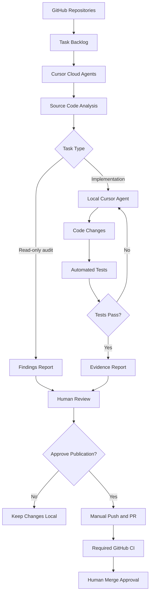
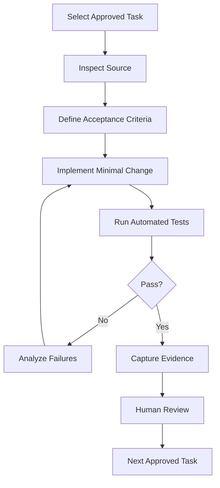

# Cursor Cloud Agents — Autonomous GitHub Development Playbook

**Owner:** Kozphy  
**Date:** 2026-11-08  
**Status:** Setup planned; implementation and validation pending  
**Version:** 1.0

**Repositories:**
- [Kozphy/EvalForge](https://github.com/Kozphy/EvalForge)
- [Kozphy/ci-failure-orchestrator](https://github.com/Kozphy/ci-failure-orchestrator)

---

## 1. Objective

Build a controlled, autonomous AI software development workflow using Cursor Cloud Agents.

### Goals
- Minimize repeated manual prompting.
- Automate code inspection and development tasks.
- Execute tests and collect verifiable evidence.
- Improve AI Governance and CI Reliability.
- Track P0/P1/P2 engineering priorities.
- Maintain human control over GitHub publication and production deployment.

### Non-negotiable restrictions
- No automatic push to GitHub.
- No automatic merging.
- No production deployment.
- No production credentials.
- No destructive repository operations.
- No fabricated testing or audit evidence.

**Important limitation:** Cursor Cloud Agents' normal GitHub workflow pushes changes to agent branches. Strict no-push requirements may require Cloud Agents only for read-only analysis and Cursor's local Agent for implementation. Disabling automatic pull requests does not necessarily disable Git pushes.

**Exception for this documentation:** This file was explicitly authorized for publication on a separate documentation branch; its presence does not authorize autonomous agent pushes.

---

## 2. Architecture



### Execution modes

| Mode | Cloud coding | Git push | Human approval |
|---|---|---|---|
| A — Strict no-push | Read-only cloud analysis; local coding | Manual only | Required |
| B — Controlled cloud coding | Autonomous | Agent branch pushes allowed | Required before merge |

**Default: Mode A.** Mode B requires an explicit policy change.

---

## 3. Tools

| Tool | Purpose |
|---|---|
| Cursor Cloud Agents | Remote autonomous analysis |
| Cursor Local Agent | Controlled implementation |
| GitHub | Source control and issue tracking |
| GitHub Actions | Automated verification |
| AGENTS.md | Persistent repository instructions |
| Cursor Automations | Scheduled and event-triggered audits |
| HackMD | Engineering documentation |
| pytest / existing test runner | Reproducible test execution |

Useful links:
- [Cursor Cloud Agents](https://cursor.com/agents)
- [Cursor Automations](https://cursor.com/automations)
- [Cursor Documentation](https://cursor.com/docs)
- [GitHub Rulesets](https://docs.github.com/en/repositories/configuring-branches-and-merges-in-your-repository/managing-rulesets/about-rulesets)

---

## 4. Repository priorities

### 4.1 EvalForge

**Mission:** Enterprise AI Evaluation and Governance.

| Priority | Task | Evidence required |
|---|---|---|
| P0 | Inspect existing evaluation architecture | File-level audit |
| P0 | MCP security boundary tests, where applicable | Negative authorization tests |
| P0 | Evaluation boundary validation | Reproducible test results |
| P0 | Governance security hardening | Security regression tests |
| P1 | RBAC | Authorization tests |
| P1 | Segregation of Duties | Permission-separation tests |
| P1 | Durable audit evidence | Persistence and integrity tests |
| P2 | Performance improvements | Benchmark comparison |
| P2 | Governance dashboard | Verified reports |

Do not assume MCP, RBAC, or other capabilities exist. Confirm implementation through source inspection.

### 4.2 ci-failure-orchestrator

**Mission:** Reproducible CI Reliability Engineering.

| Priority | Task | Evidence required |
|---|---|---|
| P0 | Inspect command execution boundaries | Permission audit |
| P0 | Prevent unauthorized CI repair actions | Security tests |
| P0 | Validate failure recovery | Integration tests |
| P1 | Benchmark reproducibility | Test datasets and logs |
| P1 | SLO reporting | Metrics and calculations |
| P1 | Audit trail improvements | Traceable events |
| P2 | Dashboard optimization | Performance measurements |
| P2 | Documentation improvements | Reproducible examples |

**Execution order:** Complete and validate P0 before P1, then P2.

---

## 5. Initial setup

### Step 1 — Access Cursor
1. Open https://cursor.com/agents.
2. Sign in.
3. Check Cloud Agent eligibility and usage limits.
4. Review GitHub integration permissions.
5. Create a separate environment for each repository.

### Step 2 — Protect GitHub
Configure repository rulesets for `main`:
- Require pull requests.
- Require successful CI checks.
- Require human approval where supported.
- Block force pushes.
- Restrict bypass permissions.
- Disable automatic merges and releases.

Rulesets protecting `main` do **not** automatically prevent pushes to new branches. For strict no-push mode, do not provide write-capable GitHub credentials to the Cloud Agent.

### Step 3 — Configure agent environments
Inspect each repository's existing runtime and dependencies. Use existing lockfiles, test commands, and supported language versions. Avoid production connections and secrets. Verify that tests execute with local fixtures or mocks.

---

## 6. Persistent AGENTS.md policy

Create `AGENTS.md` in the repository root:

```markdown
# Kozphy Autonomous Development Policy

## Objective
Improve software quality with reproducible evidence.

## Priorities
1. P0 security
2. P0 governance
3. P0 validation
4. P1 reliability
5. P2 optimization

## Development Rules
- Inspect code before modification.
- Implement one small task at a time.
- Use existing project conventions.
- Run relevant tests.
- Report actual results.
- Never fabricate evidence.

## Security Rules
- No production deployments.
- No production credentials.
- No destructive operations.
- No unauthorized external API calls.
- No weakening security controls to pass tests.

## Git Rules
- Do not push automatically.
- Do not merge automatically.
- Do not create releases.
- Do not change GitHub permissions.
- Do not modify deployment workflows.
- Stop if the platform requires a prohibited push.

## Evidence Requirements
Report:
1. Files inspected
2. Files changed
3. Test commands
4. Test results
5. Security implications
6. Remaining limitations

## Human Review
All publication and deployment decisions
require explicit human authorization.
```

**Security note:** `AGENTS.md` provides instructions, not permission enforcement. Use actual sandbox restrictions, repository permissions, and protected workflows.

---

## 7. First Cursor Cloud Agent prompt

```text
Role:
Senior AI Systems Engineer and Technology Risk Auditor.

Repository:
Kozphy/EvalForge

Mission:
Perform a read-only enterprise AI governance audit.

Tasks:
1. Inspect existing architecture.
2. Identify actual implemented capabilities.
3. Compare source code against documentation.
4. Inspect testing and security boundaries.
5. Identify unsupported implementation claims.
6. Produce a P0/P1/P2 backlog.

For each finding provide:
- File path
- Evidence
- Risk level
- Proposed correction
- Verification method

Restrictions:
- No source modifications.
- No Git push.
- No pull requests.
- No merges.
- No production deployment.
- No production credentials.

Stop if requested actions conflict with these restrictions.
Do not invent findings or evidence.
```

The first run should establish a verified baseline before implementation is authorized.

---

## 8. Autonomous development cycle



Stop when:
- The iteration or spending budget is exhausted.
- A security-sensitive decision requires approval.
- Tests cannot be reproduced.
- Required permissions are unavailable.
- A task requires production access.

Do not allow unlimited retry loops.

---

## 9. Cursor Automations

Start with read-only scheduled audits.

| Automation | Frequency | Objective |
|---|---|---|
| EvalForge P0 Audit | Monday 09:00 Asia/Taipei | Identify unresolved governance risks |
| CI Reliability Review | Thursday 09:00 Asia/Taipei | Review failed tests and reliability risks |
| Pull Request Risk Review | On PR creation | Review proposed changes |

Example prompt:

```text
Perform a read-only engineering audit.

Identify:
- Security regressions
- Failed tests
- Unresolved P0 findings
- Missing evidence
- Unsupported claims

Provide file paths and verification steps.

Do not edit, push, merge, deploy,
or alter repository settings.
```

For strict read-only execution, configure the connected identity without repository write permissions.

---

## 10. CI verification requirements

Before accepting implementation work, identify and enable:
- Unit testing
- Integration testing where applicable
- Security regression testing
- Authorization and permission testing
- Code quality and formatting checks
- Dependency vulnerability review
- Audit evidence integrity

Mark a task complete only after acceptance criteria are tested. Record exact commands, results, and environment details.

---

## 11. Evidence maturity model

| Level | Description |
|---|---|
| E0 | Claimed feature |
| E1 | Design documentation |
| E2 | Implemented source code |
| E3 | Automated tests passing |
| E4 | Reproducible integration evidence |
| E5 | Independent external validation |

These are internal portfolio labels, not an official audit standard. Target reproducible integration evidence and independent review. Passing tests is not proof a system is defect-free.

---

## 12. Safety verification checklist

### GitHub
- [ ] Default branch is protected
- [ ] Force pushes are blocked
- [ ] Required CI checks are enabled
- [ ] Automatic merging is disabled
- [ ] No agent bypass permissions exist
- [ ] Strict no-push access restrictions are verified

### Cursor
- [ ] Environment is isolated
- [ ] Production credentials are absent
- [ ] Repository instructions are configured
- [ ] Read-only agent behavior is tested
- [ ] Usage limits are reviewed
- [ ] Failure and stop conditions are defined

### Engineering
- [ ] Existing source code is audited
- [ ] P0 backlog is evidence-based
- [ ] Test suite executes reproducibly
- [ ] Security boundaries are tested
- [ ] Evidence reports are generated
- [ ] Human review process is documented

---

## 13. Execution roadmap

### Phase 1 — Foundation
- [ ] Configure Cursor access
- [ ] Validate repository permissions
- [ ] Create development environments
- [ ] Add AGENTS.md
- [ ] Establish testing baseline

### Phase 2 — Security
- [ ] Audit EvalForge P0 controls
- [ ] Validate MCP authorization boundaries where present
- [ ] Validate evaluation isolation
- [ ] Audit CI repair execution permissions

### Phase 3 — Governance
- [ ] Implement approved RBAC controls
- [ ] Implement segregation-of-duties tests
- [ ] Add durable audit evidence
- [ ] Validate evidence integrity

### Phase 4 — Reliability
- [ ] Improve CI regression testing
- [ ] Add reproducible benchmarks
- [ ] Improve SLO calculations
- [ ] Produce technical verification reports

### Phase 5 — External Validation
- [ ] Request independent code review
- [ ] Document reviewed findings
- [ ] Obtain reproducible external testing evidence
- [ ] Publish a verified engineering case study

---

## 14. Success metrics

| Metric | Target |
|---|---|
| Automatic production deployments | 0 |
| Unauthorized Git pushes | 0 |
| Automatic merges | 0 |
| P0 findings without disposition | 0 before P1 |
| Completed tasks without validation evidence | 0 |
| Human approval for publication | 100% |
| Reproducible tests | Required per completed task |

These are intended controls, not current measurements.

---

## 15. Final strategy

**Recommended workflow:**

Cursor Cloud Agents → Read-only auditing → Prioritized development backlog → Cursor Local Agent → Automated testing → Evidence collection → Human review → Manual GitHub publication.

Fully unattended cloud coding requires explicit authorization of controlled agent-branch pushes and validation of safeguards.

### Key principle

**Claim → Evidence → Verification → Decision**

Autonomous AI development improves implementation efficiency, but trustworthy engineering requires independently verifiable results.

---

## References
- [Cursor](https://cursor.com/)
- [Cursor Cloud Agents](https://cursor.com/agents)
- [Cursor Automations](https://cursor.com/automations)
- [Cursor Documentation](https://cursor.com/docs)
- [GitHub Rulesets](https://docs.github.com/en/repositories/configuring-branches-and-merges-in-your-repository/managing-rulesets/about-rulesets)
- [Ralph Autonomous Agent](https://github.com/snarktank/ralph)

**Document status:** Planning reference. Publishing this document is not evidence that Cloud Agents, tests, or production systems have been configured.
